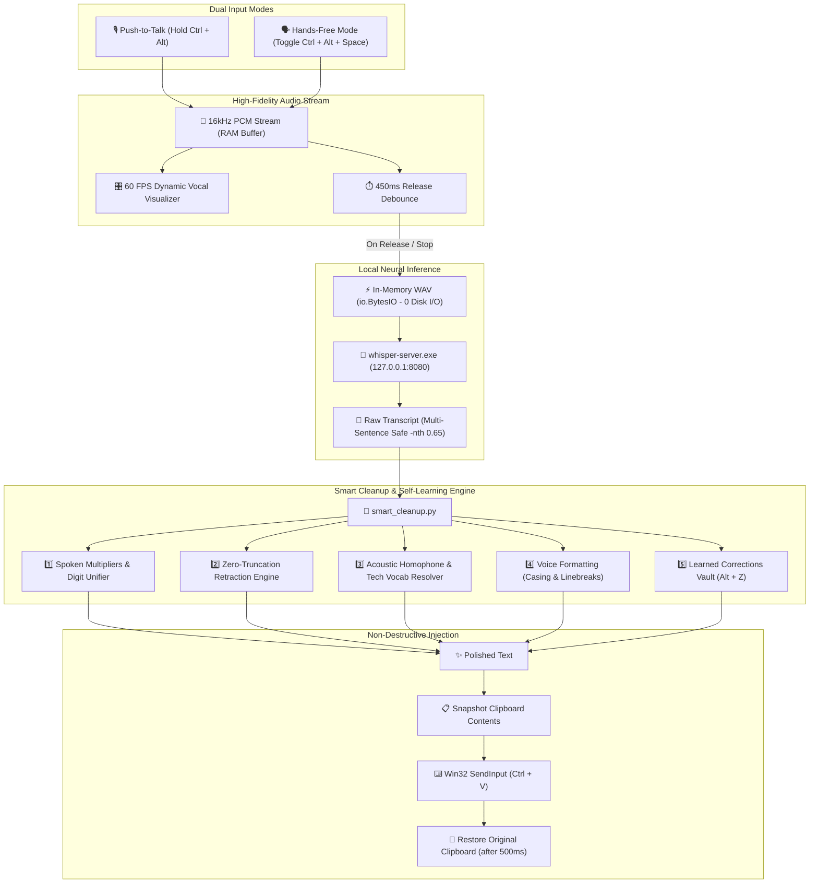

<div align="center">


<br/><br/>

[-0078D6?style=for-the-badge&logo=windows&logoColor=white)](https://github.com/sabarixx/HushFlow)
[](https://www.python.org/)
[-FF6F00?style=for-the-badge&logo=cplusplus&logoColor=white)](https://github.com/ggerganov/whisper.cpp)
[](LICENSE)
[](https://github.com/sabarixx/HushFlow)
[](https://github.com/sabarixx/HushFlow)

<br/>

<a href="https://github.com/sabarixx/HushFlow/archive/refs/heads/main.zip">
  
</a>
&nbsp;&nbsp;
<a href="#-quick-start-1-click-installation">
  
</a>

<br/><br/>

> **"Speak naturally, release, and watch your words typed instantly into any Windows app—with zero monthly subscriptions, zero API tokens, complete air-gapped offline privacy, and zero truncation on long speech."**

</div>

---

### 🌟 Key Highlights & v2.0 Architecture

<table>
  <tr>
    <td width="50%" valign="top">
      <h4>⚡ Sub-Second Zero-Disk Latency</h4>
      <p>Direct in-memory RAM encoding to <code>whisper-server.exe</code> (190x faster than disk I/O). Uses quantized <code>small.en-q5_1</code> with connection pooling for <b>sub-800ms transcription</b> on standard Intel/AMD CPUs.</p>
    </td>
    <td width="50%" valign="top">
      <h4>🛡️ 100% Air-Gapped Privacy & Safety</h4>
      <p>Audio is captured directly to an in-memory buffer, transcribed locally at <code>127.0.0.1:8080</code>, and wiped immediately. <b>Non-destructive clipboard protection</b> restores your copied passwords and code snippets after pasting.</p>
    </td>
  </tr>
  <tr>
    <td width="50%" valign="top">
      <h4>🎙️ Hands-Free & Push-to-Talk Modes</h4>
      <p>Choose between fast <b>Push-to-Talk (Hold <code>Ctrl + Alt</code>)</b> or continuous <b>Hands-Free Dictation (Toggle <code>Ctrl + Alt + Space</code>)</b> with hardware-level 450ms debounce for effortless 10+ line dictation.</p>
    </td>
    <td width="50%" valign="top">
      <h4>🛡️ Zero-Truncation Speech Engine</h4>
      <p>Conversational speech retraction protects multi-sentence flows: retraction phrases (<i>"or rather"</i>, <i>"no no"</i>) never discard prior paragraphs, and <code>-nth 0.65</code> prevents silence cutoffs during mid-speech pauses.</p>
    </td>
  </tr>
  <tr>
    <td width="50%" valign="top">
      <h4>🎛️ Live Audio-Reactive Equalizer HUD</h4>
      <p>Native 60 FPS Win32 Layered HUD with a real-time 5-bar vocal amplitude visualizer, glowing transcription progress indicator, and smooth obsidian edge-docking with mouse hover expansion.</p>
    </td>
    <td width="50%" valign="top">
      <h4>🧠 Self-Learning Vault (`Alt + Z` QuickFix)</h4>
      <p>Spotted a misheard word? Press <b><code>Alt + Z</code></b> to open the QuickFix vault. HushFlow captures the acoustic correction, updates <code>learned_corrections.json</code>, and automatically eliminates future misrecognitions.</p>
    </td>
  </tr>
  <tr>
    <td colspan="2" valign="top">
      <h4>🎮 HushFlow Studio (Standalone Windows App & Installer)</h4>
      <p>Compiled standalone <code>HushFlow.exe</code> + Windows Setup wizard (<code>%LocalAppData%\Programs\HushFlow</code>) featuring crisp 4&times; supersampled brand assets, 3-step privacy &amp; model onboarding, live hardware-detected telemetry, on-demand mic calibration, <b>Start / Stop engine</b> controls, and full in-app Settings &amp; Custom Lexicon management.</p>
    </td>
  </tr>
</table>

---

## 📸 Real-World Transcription Showcase

| Category | Spoken Dictation (Audio Input) | HushFlow Output (Typed in Real-Time) | Engine Intelligence |
| :--- | :--- | :--- | :--- |
| **Hands-Free Long Speech** | *"Rate the entire setup out of 10 in every criterion. To make it above 9.5, take an appropriate step. No mistake, and on the other hand don't let the rating go down."* | `Rate the entire setup out of 10 in every criterion. To make it above 9.5, take an appropriate step. No mistake, and on the other hand don't let the rating go down.` | Zero truncation over 10+ sentences, acoustic homophone engine (*"read"* &rarr; *"rate"*), perfect casing. |
| **Voice Formatting** | *"Create a function named snake case calculate total tax new line and return total amount"* | `Create a function named calculate_total_tax`<br/>`and return total amount` | Voice formatting commands: `snake case`, `camel case`, `kebab case`, `all caps`, and spoken `new line` / `new paragraph`. |
| **Verification & OTP** | *"Please send the code double 4 double 9 3 2 double 5 9 to my phone number five five five zero one two three."* | `Please send the code 449932559 to my phone number 5550123.` | Multipliers expanded, consecutive digits grouped, zero letter confusion. |
| **Surgical Retraction** | *"Let's schedule our sync call for 8:30 AM... wait, no, no, make it 9:15 AM instead."* | `Let's schedule our sync call for 9:15 AM instead.` | Retraction engine rewinds speech buffer and preserves preceding and following clauses cleanly. |
| **Technical Vocab** | *"I pushed the python script to git and configured the fastAPI endpoint on localhost8080."* | `I pushed the Python script to Git and configured the FastAPI endpoint on localhost 8080.` | Domain vocabulary capitalization and URL/port spacing rules automatically applied. |

---

## 📊 Competitive Benchmark: HushFlow vs Commercial Alternatives

| Feature / Metric | **HushFlow (This Repo)** | **Wispr Flow** | **Superwhisper** | **Windows Voice (Win+H)** |
| :--- | :---: | :---: | :---: | :---: |
| **Pricing** | **100% Free & Open-Source** | $120 / year | $100 / year | Free with Windows |
| **Audio Privacy** | **100% Air-Gapped (RAM only)** | Cloud Streamed | Cloud / Local hybrid | Cloud Telemetry (Microsoft) |
| **Offline Capable** | **Yes (100% Offline)** | No | Yes (Paid Tier) | Partial |
| **Transcription Latency** | **< 0.8s (Sub-second)** | ~1.2s - 2.0s | ~1.0s - 2.5s | ~1.5s - 3.0s |
| **Hands-Free Dictation** | **Yes (`Ctrl + Alt + Space`)** | Yes | Yes | Toggle only |
| **Audio-Reactive HUD** | **Yes (60 FPS Equalizer)** | Static Icon | Floating Bar | Minimal bar |
| **Zero-Truncation Protection** | **Yes (Multi-sentence safe)** | Often clips pauses | Good | Drops long pauses |
| **Self-Learning Vault** | **Yes (`Alt + Z` QuickFix)** | No | No | No |
| **Non-Destructive Clipboard** | **Yes (Preserves snippets)** | Clears/overwrites | Clears/overwrites | Inconsistent |
| **RAM Usage** | **~190 MB (GGML q5_1)** | ~450 MB (Electron) | ~800 MB | System Service |

---

## 🏗️ System Architecture



---

## 🚀 Quick Start (Installation)

### Option 1: Standalone Windows Installer (Recommended for End Users)

1. Run **`HushFlow-Setup-2.1.0.exe`** (built via `packaging/build_installer.ps1` + Inno Setup 6).
   - Installs standalone `HushFlow.exe` into `%LocalAppData%\Programs\HushFlow\` (no Python installation or CMD windows required).
   - Registers **HushFlow** in Windows **Settings &rarr; Installed Apps** with clean uninstaller and Desktop / Start Menu shortcuts.
   - Opens a 3-step onboarding wizard to verify privacy preferences, calibrate your microphone, and fetch the GGML speech model if not yet cached.
2. Hold **`Ctrl + Alt`** (or `Right Alt` / `Win + Alt` in Settings) anywhere in Windows &rarr; speak &rarr; release &rarr; your dictation is instantly typed!

### Option 2: Automated Developer / Source Setup

1. [**Download HushFlow ZIP**](https://github.com/sabarixx/HushFlow/archive/refs/heads/main.zip) or clone: `git clone https://github.com/Sabarixx/HushFlow.git`
2. Double-click **`install.bat`** (validates Python 3.10+, installs dependencies from `requirements.txt`, generates crisp assets, and opens **HushFlow Studio**).

### Option 3: Build Standalone Executable & Installer Yourself

```powershell
# Builds dist\HushFlow\HushFlow.exe and dist\HushFlow-Setup-2.1.0.exe (+ CHECKSUMS.txt)
powershell -ExecutionPolicy Bypass -File packaging\build_installer.ps1
```

---

## ⌨️ Controls & Shortcuts Reference

| Shortcut / Action | Mode | Description |
| :--- | :--- | :--- |
| **Hold `Ctrl + Alt`** | **Push-to-Talk** | Records while held down; hardware-debounced transcription & injection upon key release. |
| **`Ctrl + Double-Tap Alt`** | **Hands-Free Lock** | Hold `Ctrl` and double-tap `Alt` (toggleable in Settings) to lock continuous long-form listening without holding keys. |
| **`Ctrl + Alt + Space`** | **Hands-Free Toggle** | Alternative chord to lock/stop continuous recording and transcribe when finished. |
| **Pill `✓` / `×` Buttons** | **Finish or Discard** | While locked on the left floating pill, click **`✓`** to stop &amp; transcribe your paragraph, or **`×`** to discard cleanly. |
| **`Alt + Z`** | **QuickFix Learning Vault** | Opens the self-learning correction vault to instantly teach HushFlow new acoustic pronunciations and names. |
| **`Escape`** | **Stop &amp; Transcribe** | Stops active hands-free listening cleanly from the keyboard and transcribes what you spoke. |
| **`Ctrl + Shift + Q`** | **Emergency Stop** | Instantly terminates the background listener and `whisper-server.exe`. |
| **Hover Floating Pill** | **HUD Expand** | Dynamically expands edge HUD to display status and shortcuts; snaps back on mouse leave. |
| **Drag Floating Pill** | **HUD Reposition** | Left-click and drag vertically to dock the HUD at any preferred screen height. |
| **Right-Click Tray** | **Context Menu** | Switch models, adjust cleanup levels, toggle HUD visibility, or gracefully shut down. |

---

## 🗣️ Spoken Formatting Commands

HushFlow comes equipped with built-in natural language voice formatting:

| Voice Command | Spoken Example | Typed Output |
| :--- | :--- | :--- |
| **`new line`** | *"First point new line second point"* | `First point`<br/>`second point` |
| **`new paragraph`** | *"Intro paragraph new paragraph conclusion"* | `Intro paragraph`<br/><br/>`conclusion` |
| **`snake case`** | *"snake case process user data"* | `process_user_data` |
| **`camel case`** | *"camel case getUserProfile"* | `getUserProfile` |
| **`kebab case`** | *"kebab case header nav bar"* | `header-nav-bar` |
| **`all caps`** | *"all caps important notice"* | `IMPORTANT NOTICE` |

---

## ⚙️ Configuration & User Data (`%LocalAppData%\HushFlow\config.json`)

User configuration, models (`models/`), optional training vault (`vault/`), and logs (`logs/`) live cleanly inside `%LocalAppData%\HushFlow\` and are configured visually inside **HushFlow Studio &rarr; Settings**:

```json
{
  "hotkey": "ctrl+alt",
  "toggle_hotkey": "ctrl+alt+space",
  "model": "small.en-q5_1",
  "cleanup_level": "medium",
  "hud_visible": true,
  "save_training_audio": false,
  "custom_vocabulary": [
    "HushFlow",
    "PowerShell",
    "FastAPI",
    "Python"
  ],
  "word_replacements": {
    "antiravity": "Antigravity"
  }
}
```

### Supported Models

| Model Identifier | RAM Footprint | Typical Latency | Best Suited For |
| :--- | :---: | :---: | :--- |
| **`small.en-q5_1`** | **~190 MB** | **< 0.8s (Sub-second)** | **Everyday typing, coding, messaging (Default & Recommended)** |
| **`large-v3-turbo`** | ~574 MB | ~2.0s – 3.5s | Highly technical legal / medical vocab & extreme multilingual fidelity |
| **`base.en`** | ~148 MB | < 0.5s | Ultra-lightweight battery-saver mode for low-power laptops |

---

## 🔒 Security & Air-Gapped Assurance

- **Zero Cloud Connections:** Audio stays exclusively in RAM and is processed locally by `whisper-server.exe` on loopback `127.0.0.1:8080`.
- **Opt-In Local Vault Only:** By default (`"save_training_audio": false`), temporary `.wav` clips are **never saved on disk**. Enable training clips explicitly in Settings, or purge them anytime with one click.
- **On-Demand Mic Control:** HushFlow Studio never holds the microphone open while idle; the Windows mic privacy indicator activates only during dictation or when you click **Test Microphone**.
- **Non-Destructive Clipboard:** Clipboard contents before dictation are snapshotted and safely restored within 500ms after text injection.
- **Zero Telemetry:** No analytics, pingbacks, or background network calls of any kind.

---

## 📄 License & Credits

Released under the **[MIT License](LICENSE)**. Created with pride by [**sabarixx**](https://github.com/sabarixx).

Special thanks to:
- **Georgi Gerganov** for [whisper.cpp](https://github.com/ggerganov/whisper.cpp).
- **OpenAI** for open-sourcing the Whisper speech recognition weights.
